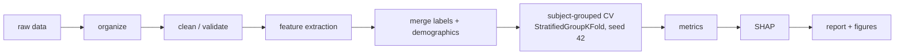

# Architecture

Status legend: **[done]** exists in `scripts/`, **[planned]** not written yet.
Script names marked planned are a suggested numbering and can be renamed.

## 1. System overview

Three independent models, each trained on its own public dataset with subject-grouped CV and
explained with SHAP. They are combined only at prediction time, by late fusion.

```mermaid
flowchart LR
    subgraph A["Model A: Gait"]
        A1[gaitpdb<br/>foot VGRF, 166 subj] --> A2[Clean + features v1/v2/v3] --> A3[Classifiers<br/>grouped CV] --> A4[P&#40;PD&#41; + H&Y stage]
    end
    subgraph B["Model B: Wrist tremor"]
        B1[PADS<br/>smartwatch, 469 subj] --> B2[Tremor / movement features] --> B3[Classifiers<br/>grouped CV] --> B4[P&#40;PD&#41;]
    end
    subgraph C["Model C: Voice"]
        C1[UCI speech #301<br/>40 subj x 26 rec] --> C2[Acoustic features] --> C3[Classifiers<br/>grouped CV] --> C4[P&#40;PD&#41;]
    end
    A4 --> S[SHAP per model]
    B4 --> S
    C4 --> S
    A4 --> F[Calibration + late fusion]
    B4 --> F
    C4 --> F
    F --> R[Patient report:<br/>PD risk + top features + summary]
    S --> R
```



Constraints:
- The datasets contain different people, so models are never trained jointly.
- Fusion runs on one patient's three recordings at prediction time and is a demo.
  Fused accuracy is not validated (no paired data); per-modality accuracy is.
- Only gaitpdb has H&Y staging. Models B and C are binary (PD vs healthy).

## 2. Data flow (per modality)



## 3. Components

### Model A: gait (gaitpdb)
| Stage | Script | Status |
|---|---|---|
| Organize by cohort/group | `01_organize_raw.py` | done |
| Clean signals | `02_clean_signals.py`, `check_cleaned_data.py` | done |
| Features v1 / v2 (stats, COP, stride CV, symmetry) | `03_extract_features.py`, `03_extract_features_v2.py` | done |
| Merge labels / demographics | `04_merge_labels.py` | done |
| DT, SVM, Bagging, NB with grouped CV | `05_train_classifiers.py` | done |
| Error diagnosis | `06_diagnose_errors.py` | done |
| 4-class / 3-class / binary | `07_train_multi_scheme.py` | done |
| Full metrics (TP/TN/FP/FN, sens, spec, PPV, NPV, F, AUC) | `08_full_metrics.py` | done |
| Class imbalance (weights, SMOTE) | `09_class_imbalance.py` | done |
| Per-cohort and leave-one-cohort-out | `10_per_cohort_analysis.py`, `11_investigate_ju_cohort.py` | done |
| Features v3 (demographics, speed, FFT/wavelet, regularity, double support) | `03_extract_features_v3.py` | done |
| RF, Extra Trees, HistGradientBoosting, LR, soft voting (feature-family ablation) | `12_train_models_v3.py` | done |
| Sliding-window LSTM (optional) | `13_lstm_windows.py` | planned |
| Leaky vs grouped comparison + figure + leak audit | `14_leakage_comparison.py` | done |

### Model B: wrist tremor / hand movement (PADS) [planned]
- Load accel and gyro per task; extract tremor-band (4-6 Hz) power, amplitude, variability,
  regularity; PD vs healthy (optional PD vs differential diagnosis).
- Scripts: `20_pads_load.py`, `21_pads_features.py`, `22_pads_train.py`.

### Model C: voice (UCI #301) [planned]
- Use the 26 provided acoustic features (jitter, shimmer, pitch, pulses), 26 recordings per
  subject. Compare recording-level vs subject-grouped CV to show the same leakage effect.
- Scripts: `30_voice_load.py`, `31_voice_train.py`, `32_voice_leakage.py`.

### Explainability and reporting [planned]
- SHAP `TreeExplainer` per model: global importance plots and per-patient waterfall plots.
- Features named clinically (stride-time CV, asymmetry, stance ratio, COP sway, tremor power,
  jitter/shimmer).
- Report: PD risk per modality and fused, top contributing features, one plain-language
  sentence. Script: `40_shap_report.py` (gait binary model done; wrist and voice pending).

### Late fusion [planned]
- Calibrate each model's probability (Platt or isotonic, fit on validation data).
- Combine by simple average or validation-AUC weights; never tune on test data.
- Script: `50_fusion_demo.py`.

## 4. Evaluation rules (apply everywhere)
- Subject-grouped `StratifiedGroupKFold`; no subject in both train and test; seed 42.
- Feature selection, scaling and augmentation happen inside training folds only.
- Windows or recordings from one subject always stay in the same fold.
- Report accuracy, macro-F1, sensitivity, specificity, AUC, with fold variance.

## 5. Data layout
```
data/raw/ raw_sorted/ interim/ processed/   gaitpdb (git-ignored)
data/raw_pads/                              PADS (git-ignored, planned)
data/raw_voice/                             UCI speech (git-ignored, planned)
docs/                                       baseline paper PDF
scripts/                                    numbered pipeline scripts
```

## 6. Patient report (target output)
```
PD risk:   gait 0.72 | wrist 0.61 | voice 0.55 | fused 0.66
Top drivers (gait):   stride-time variability (+), left-right asymmetry (+), stance ratio (+)
Summary:   Elevated PD risk, driven mainly by high stride variability and asymmetric stance.
Note:      Research screening estimate, not a diagnosis.
```
(Numbers are illustrative.)
